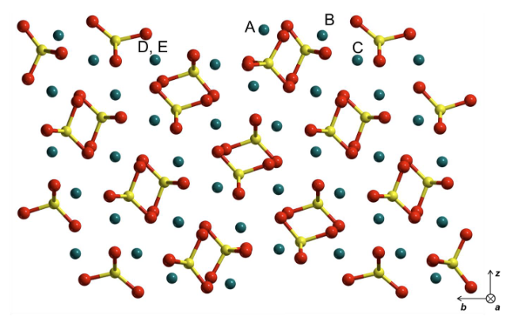

# polycleaver

polycleaver builds non-polar, charge-neutral and stoichiometric surface slabs of
complex minerals from a bulk structure file, ready to be relaxed with density
functional theory (DFT) or machine-learned potentials. It is designed for ionic
solids built on a polyanion scaffold, such as silicates, phosphates and
sulphates, including minerals that contain structural hydroxyl, crystal water or
intercalated molecules (for example hydroxyapatite or struvite).

**Version 1.0.0 (21 November 2026)** is a complete rewrite of the original
polycleaver (0.x, 2022–2024). The rewrite was developed during 2026 in a separate
repository under the name PolyCleaver 2; its history has been merged into this
repository, which is now the only home of the project. The 0.x code is kept at
the tag [`v0.0.8`](https://github.com/ericmates/polycleaver/tree/v0.0.8) and can
still be installed with `pip install polycleaver==0.0.8`. See
[Version history](#version-history) for what changed.

---

## How it works

polycleaver rebuilds every slab from a chemical classification of the bulk, in
six steps.

1. The bulk is analysed and each atom is classified as a scaffold centre (Si,
   P, S, Al, …), a scaffold oxygen, a counter-cation (Mg²⁺, Ca²⁺, K⁺, …) or an
   atom of a discrete molecule (H₂O, OH⁻, NH₃, NH₄⁺, …). Structural hydroxyl
   groups stay attached to their polyhedra, and the hydration shell of each
   cation is measured (six H₂O per Mg²⁺ in struvite, for instance).
2. The bulk is cut with the `SlabGenerator` of pymatgen and each raw slab is
   stripped to its covalent scaffold. For minerals with isolated polyhedra every
   polyhedron is kept intact; for chain, sheet and framework silicates the
   broken surface tetrahedra are kept.
3. The scaffold is thinned layer by layer and every thickness state is recorded.
4. The cations are placed back by a combinatorial search over the candidates
   closest to the centre of the slab, minimising the dipole moment along the
   surface normal (z).
5. The molecules are placed back in the same way. Water molecules are sorted
   by their distance to the nearest cation, computed with periodic boundary
   conditions, and other species by their distance to the centre of the slab.
6. A slab is accepted only if its residual dipole |μ<sub>z</sub>| is below the
   tolerance (0.3 e·Å by default) and its net charge is zero. The accepted
   slabs are ranked by the number of broken bonds per Ų, which follows the
   order of the PBE surface energies of three forsterite (110) terminations,
   and one CIF file is written per unique termination.

In single-target mode polycleaver keeps, for each cut, the thinnest valid slab
above a given thickness; in range mode it returns every valid termination
between two thicknesses.

### Supported structures

| Structure type | Example | Treatment |
|---|---|---|
| Isolated polyhedra (nesosilicates, phosphates, sulphates) | forsterite Mg₂SiO₄, hydroxyapatite | incomplete surface polyhedra are removed; the cations cancel the dipole of the scaffold |
| Chain silicates (pyroxenes) | diopside CaMgSi₂O₆, enstatite | layer-wise thinning; non-stoichiometric cuts are rejected by the charge check |
| Sheet and framework silicates | micas, feldspars, zeolites | broken surface tetrahedra are kept and the scaffold dipole is filtered before the cations are placed (implemented, with fewer validated examples than for isolated polyhedra) |
| Structural hydroxyl | hydroxyapatite Ca₁₀(PO₄)₆(OH)₂, kaolinite | OH⁻ treated as a molecular species, or H attached to its Al/Si unit |
| Hydrated or intercalated molecules | struvite MgNH₄PO₄·6H₂O | H₂O and NH₄⁺ placed combinatorially, water next to the cations |
| Disordered CIF files (Fe/Mg, Al/Si, vacancies) | Al/Si on the tetrahedral sites of muscovite | ordered with the Ewald-ranked `OrderDisorderedStructureTransformation` of pymatgen; a warning is issued if the ordered cell is not charge-neutral |
| Charged or non-stoichiometric terminations | reactivity studies | optional `allow_nonstoichiometric`; the files are tagged `_NS` |

Structures without a polyanion scaffold (simple oxides, sulphides, metals) are
outside the scope of the program, and so are surfaces that are polar by
construction, such as the (001) face of 1:1 clays like kaolinite, whose neutral
layer carries an intrinsic dipole. Disulphides such as pyrite (FeS₂), which
polycleaver 0.x accepted, are not handled by version 1.0 because the S₂²⁻
dimers are not recognised as a scaffold; use `polycleaver==0.0.8` for them.

---

## Installation

polycleaver requires Python ≥ 3.10, pymatgen, ase and numpy.

### With pip

```bash
pip install polycleaver
```

Optional extras add the server for LLM agents (`mcp`), the backend of the web
interface (`webapp`), MACE-MP relaxations in the web interface (`optimize`) and
the test suite (`test`):

```bash
pip install "polycleaver[mcp]"
```

To install the development version directly from GitHub:

```bash
pip install "git+https://github.com/ericmates/polycleaver.git"
```

### With conda

The repository contains an environment file that installs every dependency
from conda-forge and polycleaver itself from the checkout:

```bash
git clone https://github.com/ericmates/polycleaver.git
cd polycleaver
conda env create -f environment.yml
conda activate polycleaver
```

Alternatively, polycleaver can be added to an existing conda environment that
already provides pymatgen and ase:

```bash
conda install -c conda-forge pymatgen ase
pip install polycleaver
```

A conda recipe for local builds is provided in `conda/recipe.yaml`
(`rattler-build build --recipe conda/recipe.yaml`).

### From source, for development

```bash
git clone https://github.com/ericmates/polycleaver.git
cd polycleaver
pip install -e ".[test,mcp]"
pytest tests/                 # add -m "not slow" to skip the full generation runs
```

---

## Usage

### Command line

The parameters of a run can be given in a JSON configuration file, on the
command line, or both (the command-line options take precedence):

```bash
polycleaver                                            # reads ./config.json
polycleaver examples/configs/forsterite_110_range.json -o out/
polycleaver -s forsterite.cif --hkl 1 1 0 --range 12 20 -o out/
polycleaver -s struvite.cif --hkl 1 0 0 --hkl 0 1 0 --thickness 14 -o out/
polycleaver -s struvite.cif --analyse-only            # bulk classification only
python -m polycleaver my_run.json                     # same as polycleaver my_run.json
```

Run `polycleaver --help` for the full list of options. The keys of the
configuration file are listed below; keys beginning with `_` are comments.

| Key | Default | Meaning |
|---|---|---|
| `filename` | — | bulk structure (CIF, POSCAR or any other format that pymatgen reads); a relative path is resolved against the directory of the configuration file |
| `target_thickness` | 15.0 | minimum slab thickness (Å); the thinnest valid state above this value is kept |
| `thickness_range` | `null` | `[min, max]` in Å; returns every valid termination in the window and overrides `target_thickness` |
| `vacuum_size` | 15.0 | vacuum on each side of the slab (Å) |
| `dipole_threshold` | 0.3 | maximum \|μ<sub>z</sub>\| of an accepted slab (e·Å) |
| `auto_select_stable` | `true` | rank the slabs by broken bonds per Ų, then symmetric slabs first, then coordination saturation |
| `allow_nonstoichiometric` | `false` | keep charged slabs as `slab_hkl_N_NS.cif` |
| `mode` | `"single"` | `"single"` (uses `single_hkl`), `"max"` (all distinct indices up to `max_index`) or `"list"` (uses `custom_list`) |

### Output files

Each run writes, in the output directory:

- one `slab_{hkl}_{i}.cif` file per accepted termination, numbered by stability rank;
- `polycleaver_summary.json`, a machine-readable record of the run: the versions
  of polycleaver, pymatgen, ase and numpy, the resolved parameters, the bulk
  classification, and for every slab its file, Miller index, formula, number of
  atoms, thickness, surface area, symmetry, residual dipole, net charge, broken
  bonds per Ų, molecular species and the hydration of the outermost cations.

The terminal report contains the same information in readable form. With
`--json`, the summary is printed on standard output and the report is sent to
standard error, so that the output can be piped to other programs.

### Python interface

```python
import polycleaver

summary = polycleaver.run(
    {"filename": "examples/structures/hydroxyapatite.cif",
     "single_hkl": [0, 1, 0], "target_thickness": 17.0},
    outdir="hap_010",
)
best = summary["slabs"][0]                 # rank 1: fewest broken bonds per Ų
print(best["path"], best["formula"], best["thickness_A"], best["dipole_z_eA"])
```

The individual steps are also available:

```python
from pymatgen.core import Structure
from polycleaver import ChemicalAnalyzer, ensure_oxidation_states, generate_slabs_for_hkl

bulk = ensure_oxidation_states(Structure.from_file("examples/structures/hydroxyapatite.cif"))
analyzer = ChemicalAnalyzer(bulk)
analyzer.print_detailed()                  # scaffold, cations, molecules, hydration

slabs = generate_slabs_for_hkl(bulk, analyzer, (0, 1, 0),
                               target_thickness=17.0, vacuum=15.0, dipole_tol=0.3)
for i, slab in enumerate(slabs):
    print(slab.formula, slab.is_symmetric(), float(slab.dipole[2]))
    slab.to(filename=f"HAP_010_{i}.cif")
```

---

## Use with LLM agents

polycleaver can be driven by large language model (LLM) agents that prepare
surface models as part of a longer computational workflow, for instance an
agent that selects surfaces, builds the slabs, places adsorbates and submits
the DFT calculations. Three routes are available, depending on what the agent
can do.

### Agents with shell access

Coding agents that run shell commands, such as Claude Code, Codex CLI or Gemini
CLI, can call the command-line interface directly. The `-s`, `--hkl`,
`--thickness` and `--range` options avoid writing a configuration file, and
`--json` returns a single JSON document on standard output:

```bash
polycleaver -s forsterite.cif --analyse-only --json
polycleaver -s forsterite.cif --hkl 1 1 0 --range 12 20 -o forsterite_110 --json
```

The agent should take its decisions from the fields of the JSON document (or of
`polycleaver_summary.json`). The layout of the terminal report is meant for
people and may change between versions, whereas the keys of the summary are
versioned through its `schema_version` field. The file [`AGENTS.md`](https://github.com/ericmates/polycleaver/blob/main/AGENTS.md)
at the root of the repository describes the installation, the tests, the layout
of the code and the checks expected after each run; coding agents that read
repository instruction files will pick it up when they work on a clone.

### Model Context Protocol server

For agents and chat applications that support the Model Context Protocol (MCP),
polycleaver provides a server that runs locally and exposes three tools:

| Tool | Purpose |
|---|---|
| `analyse_structure` | classifies the atoms of a bulk structure and reports whether the cell is charge-neutral |
| `list_miller_indices` | lists the symmetrically distinct Miller indices up to a maximum index |
| `generate_slabs` | runs the full pipeline and returns the run summary, with the path of every CIF file |

Install the extra and register the `polycleaver-mcp` command with the client.
For Claude Code:

```bash
pip install "polycleaver[mcp]"
claude mcp add polycleaver -- polycleaver-mcp
```

Most other clients (Claude Desktop, Cursor, Gemini CLI, …) read a JSON
configuration of the following form:

```json
{
  "mcpServers": {
    "polycleaver": {
      "command": "/full/path/to/env/bin/polycleaver-mcp"
    }
  }
}
```

The full path is needed when polycleaver is installed in a conda or virtual
environment that the client does not activate (`which polycleaver-mcp` prints
it). The server reads and writes files with the permissions of the user who
starts the client, and each call to `generate_slabs` writes the CIF files,
`polycleaver_summary.json` and the full text report (`polycleaver.log`) to the
`output_dir` given by the agent. The server also sends the client a short set of
instructions on how the tools should be used, which repeats the checks listed
below.

### Agent frameworks with Python tools

Frameworks that accept Python functions as tools can register `polycleaver.run`
and `polycleaver.analyse` directly, or a thin wrapper that returns only the
fields the model needs:

```python
import polycleaver

def generate_slabs(structure_path: str, miller_index: list[int],
                   thickness_range: list[float], output_dir: str) -> list[dict]:
    """Build non-polar, stoichiometric slabs of a mineral and return them ranked by stability."""
    summary = polycleaver.run({"filename": structure_path,
                               "single_hkl": miller_index,
                               "thickness_range": thickness_range},
                              outdir=output_dir)
    keys = ("rank", "path", "formula", "thickness_A", "symmetric",
            "dipole_z_eA", "stoichiometric", "broken_bonds_per_A2")
    return [{k: slab[k] for k in keys} for slab in summary["slabs"]]
```

`polycleaver.run` prints its report on standard output; wrap the call in
`contextlib.redirect_stdout` if the framework uses standard output for its own
messages.

### Checks expected from an agent

An agent that builds slabs with polycleaver should apply the same checks as a
careful user, and report them:

1. Analyse the bulk before generating slabs. If `charge_neutral` is false, or the
   classification does not match the mineral (for example crystal water counted
   as part of the scaffold, or a missing cation), the agent should report the
   problem instead of continuing.
2. State the Miller indices, the thickness or thickness range and the dipole
   tolerance used. The default tolerance of 0.3 e·Å should only be relaxed with
   the agreement of the user, and the residual dipole of the selected slab should
   then be reported with it.
3. Check the selected slab in the summary: `stoichiometric` true,
   `dipole_within_tolerance` true, and whether it is symmetric.
4. Describe the stability rank for what it is, namely an estimate based on
   broken bonds in the unrelaxed slab. Surface energies require relaxing the
   slabs with DFT or a machine-learned potential.
5. Keep `polycleaver_summary.json` next to the CIF files, since it records the
   parameters and the library versions needed to reproduce the slabs.

---

## Examples and validation

All configurations in `examples/configs/` run in less than 15 s on a laptop.

| Configuration | System | Result |
|---|---|---|
| `forsterite_110_range.json` | Mg₂SiO₄ (110), 12–20 Å | 8 unique terminations. Rank 1 is the symmetric Mg₃₂Si₁₆O₆₄ slab of 14.99 Å with zero dipole, the same termination as the DFT-relaxed reference `examples/reference/POSCAR_forsterite_110_DFT` |
| `forsterite_010.json` | Mg₂SiO₄ (010), ≥ 10 Å | 2 terminations with zero dipole: a symmetric Mg₂₀Si₁₀O₄₀ slab of 14.92 Å (rank 1) and an asymmetric Mg₁₂Si₆O₂₄ slab of 11.55 Å. The bare SiO₄ scaffold is polar on this face and the placement of Mg²⁺ cancels its dipole |
| `hydroxyapatite_010.json` | Ca₁₀(PO₄)₆(OH)₂ (010), ≥ 17 Å | Ca₂₀(PO₄)₁₂(OH)₄ (88 atoms, 17.71 Å), symmetric, with zero dipole, the same termination as `POSCAR_hydroxyapatite_010_DFT`; cuts with a number of P centres that is not a multiple of three are rejected as charged |
| `struvite_low_index.json` | MgNH₄PO₄·6H₂O, (100), (010) and (001), ≥ 14 Å | 8 terminations. The four (100) and (010) slabs are symmetric, with zero dipole and complete Mg(H₂O)₆ shells at both surfaces; the four (001) slabs are asymmetric (0.12 e·Å) and at least one of their outermost Mg²⁺ ions keeps five of its six water molecules |
| `diopside_max1.json` | CaMgSi₂O₆, all indices ≤ 1 | 7 symmetric terminations on 5 planes; polar and non-stoichiometric cuts are discarded |

These results were obtained with polycleaver 1.0.0, pymatgen 2026.10.24, ase
3.29.0 and numpy 2.4.6. Because the cuts themselves come from the
`SlabGenerator` of pymatgen, the list of terminations can change slightly
between pymatgen versions: with pymatgen 2026.5, for example, the asymmetric
11.55 Å slab of forsterite (010) is replaced by a symmetric Mg₁₆Si₈O₃₂ slab of
11.94 Å. The versions used in each run are recorded in
`polycleaver_summary.json`.

The stability ranking was checked against the PBE surface energies of three
forsterite (110) terminations. The number of broken bonds per Ų reproduces the
DFT order (1.74 < 1.81 < 1.90 J m⁻²), whereas the per-atom average of the
coordination saturation gives the opposite order; see
[`docs/DESIGN_NOTES.md`](docs/DESIGN_NOTES.md).

---

## Documentation

- [`docs/HOW_IT_WORKS.md`](docs/HOW_IT_WORKS.md): a plain-language description of the pipeline, with troubleshooting advice.
- [`docs/ALGORITHM_FLOWCHART.md`](docs/ALGORITHM_FLOWCHART.md): the complete flowchart of the algorithm.
- [`docs/DESIGN_NOTES.md`](docs/DESIGN_NOTES.md): the design decisions (framework versus isolated polyhedra, the size of the combinatorial search, the charge check, the stability metric, the DFT validation and the known limitations).
- [`docs/WEBAPP.md`](docs/WEBAPP.md): the Surface Lab web interface.

## Web interface (Surface Lab)

The `api/` (FastAPI) and `frontend/` (React and Three.js) directories contain an
interactive interface in which a CIF file can be uploaded, its chemistry
inspected, and the slabs generated, viewed with their coordination polyhedra
and downloaded. Bulk and slabs can optionally be relaxed with MACE-MP to obtain
surface energies and a Wulff shape.

```bash
pip install -e ".[webapp]"
uvicorn api.main:app --reload --port 8000     # backend, from the root of the repository
cd frontend && npm install && npm run dev     # frontend on http://localhost:5173
```



---

## Version history

- **0.x (2022–2024).** The original pipeline, described in Mates-Torres & Rimola,
  *J. Appl. Cryst.* **57**, 503–508 (2024). It handled silicates, sulphates,
  phosphates, carbonates and sulphides such as pyrite by trimming the cations
  sequentially, without molecular species. Its last release is available at the tag
  [`v0.0.8`](https://github.com/ericmates/polycleaver/tree/v0.0.8) and on PyPI as
  `polycleaver==0.0.8`.
- **1.0.0 (November 2026).** A rewrite that adds molecular species (H₂O, OH⁻,
  NH₃, NH₄⁺), the combinatorial placement of cations and molecules to cancel the
  dipole, the enumeration of all terminations in a thickness range, the
  broken-bond stability ranking, the JSON summary, the MCP server and the web
  interface. It was developed as PolyCleaver 2 in the repository
  `ericmates/polycleaver2`, whose history is merged here; that development
  snapshot is archived on Zenodo
  ([doi:10.5281/zenodo.22831344](https://doi.org/10.5281/zenodo.22831344)). The
  Python interface of 0.x (`polycleaver.core`) is not kept.

The changes of each release are listed in [`CHANGELOG.md`](https://github.com/ericmates/polycleaver/blob/main/CHANGELOG.md).

## Related tools

- **SALAMI** (Xie *et al.*, [arXiv:2608.28903](https://arxiv.org/abs/2608.28903), 2026) builds symmetric, stoichiometric slabs of multinary compounds by the combinatorial removal of surface atoms under coordination constraints, with Ewald or interatomic-potential pre-screening. polycleaver instead rebuilds each slab from a chemically classified scaffold, which is what allows hydrated and intercalated species to be placed.
- **pymatgen** (`get_tasker2_slabs`) and **surfaxe** generate non-polar slabs by moving ions or selecting layers, without a chemical classification of the structure.

## Citation

If you use polycleaver, please cite the original paper:

> E. Mates-Torres and A. Rimola, *J. Appl. Cryst.* **57**, 503–508 (2024).
> [doi:10.1107/S1600576724001286](https://doi.org/10.1107/S1600576724001286)

together with the version of the software you used (see [`CITATION.cff`](https://github.com/ericmates/polycleaver/blob/main/CITATION.cff)).
A paper describing version 1.0 is in preparation.

## Licence

polycleaver is distributed under the GNU General Public License v3.0 (see
[`LICENSE`](https://github.com/ericmates/polycleaver/blob/main/LICENSE)). The example structures come from the Crystallography Open
Database (struvite COD 9007674, kaolinite COD 9009234) and from published DFT
work; their headers carry the original attribution.
