# PolyCleaver 2 — Full Algorithm Flowchart

```mermaid
flowchart TD
    classDef startend  fill:#1b4332,color:#fff,stroke:#081c15,rounded:true
    classDef process   fill:#264653,color:#fff,stroke:#1a2f38
    classDef decision  fill:#e9c46a,color:#000,stroke:#f4a261
    classDef discard   fill:#e63946,color:#fff,stroke:#a8201a
    classDef accept    fill:#2a9d8f,color:#fff,stroke:#21867a
    classDef loop      fill:#457b9d,color:#fff,stroke:#1d3557

    START(["▶ START\npython polycleaver2"]):::startend
    START --> LoadConfig["Load config.json\ntarget_thickness · vacuum · dipole_tol\nmode · hkl"]:::process
    LoadConfig --> LoadCIF["Load bulk CIF\nStructure.from_file()"]:::process
    LoadCIF --> OxiState["Assign oxidation states\npymatgen guess → fallback to OXI_MAP"]:::process

    OxiState --> BA1

    subgraph BulkAn["① BULK CHEMICAL ANALYSIS — ChemicalAnalyzer(bulk)"]
        direction TB
        BA1["Build covalent adjacency graph\nr = 2.8 Å · X–H bond < 1.25 Å · other < 2.3 Å"]:::process
        BA2["DFS: find connected components\n(covalent clusters)"]:::process
        BA3["Classify every atom:\n• non-covalent element  →  cation\n• cluster containing a centre atom  →  scaffold\n• cluster with no centre atom  →  molecule"]:::process
        BA4["Record bulk CN per centre species\nRecord cation hydration targets\nCompute stoichiometric ratios\ncation/centre  ·  molecule/centre"]:::process
        BA1 --> BA2 --> BA3 --> BA4
    end

    BA4 --> ScafCheck{"Scaffold\ndetected?"}:::decision
    ScafCheck -- No --> EXIT(["✕ EXIT — no polyanion scaffold found"]):::discard
    ScafCheck -- Yes --> MC1

    subgraph ModeSelect["② SELECT MILLER INDICES"]
        direction LR
        MC1{"mode?"}:::decision
        MC2["single_hkl"]:::process
        MC3["get_symmetrically_distinct_miller_indices\nup to max_index"]:::process
        MC4["custom_list"]:::process
        MC1 -- single --> MC2
        MC1 -- max --> MC3
        MC1 -- list --> MC4
    end

    MC2 & MC3 & MC4 --> HKLIter(["🔁 for each Miller index hkl"]):::loop

    HKLIter --> GenSlabs["③ SlabGenerator\ngen_thickness = target + 10 Å buffer\nSlabGenerator.get_slabs()  →  N unique cuts"]:::process

    GenSlabs --> CutIter(["🔁 for each cut i"]):::loop

    CutIter --> Ortho["get_orthogonal_c_slab()\nOrthogonalise c-axis"]:::process
    Ortho --> CapturePool["ChemicalAnalyzer on full cut\n→ save cation pool\n→ save molecule pool\n(these candidates are used in Phases 1 & 2)"]:::process

    CapturePool --> ST1

    subgraph StripSub["④ STRIP TO SCAFFOLD — step_5_strip_to_scaffold()"]
        direction TB
        ST1["Remove all cations + molecules"]:::process
        ST2{"Framework\nsilicate?"}:::decision
        ST3["Remove surface-incomplete polyhedra\n(current CN < bulk CN for that centre species)"]:::process
        ST4["Cascade-remove O atoms\nno longer bonded to any remaining centre"]:::process
        ST1 --> ST2
        ST2 -- "No — isolated polyhedra" --> ST3 --> ST4
        ST2 -- "Yes — framework / sheet" --> ST4
    end

    ST4 --> ScafEmpty{"Scaffold\nempty?"}:::decision
    ScafEmpty -- Yes --> Disc1(["✕ Discard cut"]):::discard
    ScafEmpty -- No --> TL_start

    subgraph ThinSub["⑤ THIN TO TARGET — step_5b_thin_to_target()"]
        direction TB
        TL_start(["Enter loop — current scaffold"]):::loop
        TL1{"dipole_z ≤ tol?"}:::decision
        TL2["Append (thickness, slab copy)\nto valid_states list"]:::process
        TL3{"Framework?"}:::decision
        TL4["_get_center_layers()\nRemove top + bottom z-layer\n(whole layer at once)"]:::process
        TL5["Sort centres by frac-z\nRemove topmost + bottommost centre\n+ their orphaned O atoms"]:::process
        TL6["Cascade-remove O\nnot bonded to remaining centres"]:::process
        TL7{"Centres\nstill present?"}:::decision
        TL8{"valid_states\nnot empty?"}:::decision
        TL9{"Any state with\nthickness ≥ target?"}:::decision
        TL10["Pick thinnest valid state\nwith thickness ≥ target"]:::process
        TL11["Pick thickest valid state\n(irreducible minimum period)"]:::process
        TFail(["return False"]):::discard
        TOK(["return True — set self.slab to best state"]):::accept

        TL_start --> TL1
        TL1 -- Yes --> TL2 --> TL3
        TL1 -- No --> TL3
        TL3 -- framework --> TL4 --> TL6
        TL3 -- isolated --> TL5 --> TL6
        TL6 --> TL7
        TL7 -- Yes --> TL_start
        TL7 -- No --> TL8
        TL8 -- No --> TFail
        TL8 -- Yes --> TL9
        TL9 -- Yes --> TL10 --> TOK
        TL9 -- No --> TL11 --> TOK
    end

    TL_start ~~~ ThinSub
    TFail --> Disc2(["✕ Discard cut"]):::discard
    TOK --> P1A

    subgraph Ph1Sub["⑥ PHASE 1 — ADD CATIONS — _combinatorial_search()"]
        direction TB
        P1A["req = round(n_centres × ratio_cation)\nSort cation pool by distance to scaffold CoM\nTake the req+4 closest as search pool"]:::process
        P1B(["🔁 for each C(req+4, req) combination:"]):::loop
        P1C["Build trial slab\nCompute |dipole_z|"]:::process
        P1D{"dipole_z ≤ tol?"}:::decision
        P1E["Update best dipole + best slab\n(track minimum)"]:::process
        P1F{"More combos\nto try?"}:::decision
        P1OK(["Return best combo found"]):::accept

        P1A --> P1B --> P1C --> P1D
        P1D -- "Yes → early exit" --> P1OK
        P1D -- No --> P1E --> P1F
        P1F -- Yes --> P1B
        P1F -- No --> P1OK
    end

    P1OK --> P1Check{"Best cation\ndipole ≤ tol?"}:::decision
    P1Check -- No --> Disc3(["✕ Discard cut"]):::discard
    P1Check -- Yes --> P2A

    subgraph Ph2Sub["⑦ PHASE 2 — ADD MOLECULES — _combinatorial_search() per species"]
        direction TB
        P2A(["🔁 for each molecular species:"]):::loop
        P2H{"Enough\ncandidates?"}:::decision
        P2B{"Water or\nOH species?"}:::decision
        P2C["Sort candidates by\nmin PBC distance from O\nto nearest cation"]:::process
        P2D["Sort candidates by\ndistance from slab centre\n(fractional z)"]:::process
        P2E["Take req+4 pool\nC(req+4, req) combos\n→ early-exit at dipole ≤ tol"]:::process
        P2F["Append best combo sites\nto final_sites_list"]:::process
        P2G{"More\nspecies?"}:::decision
        P2Fail(["return False"]):::discard
        P2Done(["All molecules placed"]):::accept

        P2A --> P2H
        P2H -- No --> P2Fail
        P2H -- Yes --> P2B
        P2B -- Yes --> P2C --> P2E
        P2B -- No --> P2D --> P2E
        P2E --> P2F --> P2G
        P2G -- Yes --> P2A
        P2G -- No --> P2Done
    end

    P2Fail --> Disc4(["✕ Discard cut"]):::discard
    P2Done --> FinalBuild["Build final slab from all site lists\nCompute total |dipole_z|"]:::process
    FinalBuild --> FinalPass{"dipole_z ≤ tol?"}:::decision
    FinalPass -- No --> Disc5(["✕ Discard cut"]):::discard
    FinalPass -- Yes --> Accept["✓ ACCEPT\nAppend slab to results"]:::accept

    Disc1 & Disc2 & Disc3 & Disc4 & Disc5 --> MoreCuts
    Accept --> MoreCuts{"More cuts?"}:::decision
    MoreCuts -- Yes --> CutIter
    MoreCuts -- No --> MoreHKL{"More hkl?"}:::decision
    MoreHKL -- Yes --> HKLIter
    MoreHKL -- No --> R1

    subgraph ReportSub["⑧ REPORT + OUTPUT"]
        direction LR
        R1["Print summary table\nformula · thickness · symmetry\ndipole · composition"]:::process
        R2["Write slab_hkl_i.cif\nfor every accepted slab"]:::process
        R1 --> R2
    end

    R2 --> END(["▶ END"]):::startend
```

---

## Key decision points and their meanings

| Decision | Yes path | No path |
|----------|----------|---------|
| Scaffold detected? | Continue | Exit — structure not supported |
| Framework silicate? | Keep under-coordinated centres | Remove incomplete polyhedra |
| Scaffold empty after strip? | Discard cut | Continue to thinning |
| Centers remaining? | Continue thinning loop | Select from valid states |
| Any valid states? | Select best | Discard cut (no non-polar scaffold) |
| Any state ≥ target? | Pick thinnest valid ≥ target | Pick thickest (irreducible minimum) |
| Best cation dipole ≤ tol? | Continue to Phase 2 | Discard cut |
| Enough molecule candidates? | Run combinatorial search | Discard cut |
| Final dipole ≤ tol? | Accept slab | Discard cut |

## Colour legend

- **Dark green** — start / end
- **Dark blue** — process step
- **Yellow** — decision (diamond)
- **Teal loop** — iteration over a list
- **Red** — discard / failure path
- **Teal accept** — success / return value
