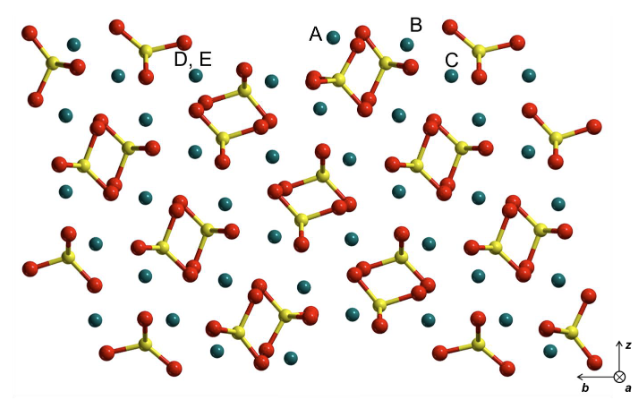

# Surface Lab — the PolyCleaver 2 web interface

A single-user FastAPI + React/Three.js front end for the generator: upload a CIF,
inspect the bulk chemistry, generate slabs for any Miller indices, view them in 3D
with coordination polyhedra and water highlighted, download CIFs, and optionally
relax bulk + slabs with the MACE-MP universal potential to obtain surface energies
and a Wulff construction.



## Backend

```bash
pip install -e ".[webapp]"                    # fastapi, uvicorn, python-multipart
uvicorn api.main:app --reload --port 8000     # run from the repository root
```

API docs: <http://localhost:8000/docs>

| Method | Path | Description |
|--------|------|-------------|
| POST | `/upload` | Multipart CIF upload → `session_id`, serialised bulk, chemical analysis |
| POST | `/generate` | Start a generation job (`thickness`, `vacuum`, `dipole_tol`, `miller_input`, optional `thickness_range`, `allow_nonstoichiometric`) → `job_id` |
| GET  | `/status/{job_id}` | Poll progress and serialised results |
| GET  | `/download/{job_id}/{idx}` | Download one slab as CIF |
| POST | `/optimize` | Relax bulk and slabs with MACE-MP, compute surface energies and a Wulff shape (needs `pip install -e ".[optimize]"`) |
| GET  | `/opt_status/{opt_job_id}` | Poll the optimisation job |

`miller_input` is `{"mode": "max", "value": 1}`, `{"mode": "single", "value": [1,1,0]}`
or `{"mode": "list", "value": [[1,0,0],[0,1,0]]}`.

## Frontend

```bash
cd frontend
npm install
npm run dev        # http://localhost:5173 — proxies /api/* to :8000
```

Stack: Vite, React 18, @react-three/fiber + drei, Tailwind, zustand.

**Note for cloud-synced folders (OneDrive, Dropbox, iCloud):** `node_modules` relies on
symlinks that these services silently convert to text files, which breaks `vite`.
Keep the checkout, or at least `frontend/`, on a local path.
